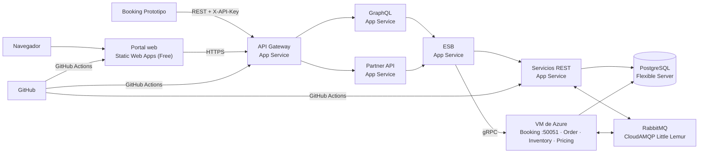

# DESPLIEGUE_AZURE_MICROSERVICIOS — Subir Descubre EC a Azure paso a paso

Guía para publicar la arquitectura de microservicios en Azure, con **Booking en una VM** (puerto TCP 50051 para gRPC) y **RabbitMQ en
CloudAMQP** (plan gratuito Little Lemur). Hay pasos que haces tú en los portales (🧑) y cambios de código que hago yo antes de
desplegar (🤖).

> **Todavía no se puede desplegar completo.** La sección 2 lista lo que falta. Crea los recursos de pago (pasos 3, 4 y 6) cuando esa
> lista esté cerrada, porque cobran desde que existen.

---

## 1. Qué servicio usa cada parte



| Parte | Servicio | Plan recomendado | Por qué |
|-------|----------|------------------|---------|
| Portal web | **Azure Static Web Apps** | Free | Archivos estáticos con HTTPS incluido |
| Gateway, GraphQL, Partner API, ESB y servicios REST | **Azure App Service** (Linux, Node 22), un solo plan | **B2** | Son 16 procesos Node. En B1 (1.75 GB) no caben con margen; varias apps comparten el plan sin costo extra |
| Booking, Order, Inventory, Pricing | **VM Linux** | **Standard_B2s** (2 vCPU, 4 GB), en Denmark East | Booking necesita abrir TCP 50051. App Service no es adecuado para gRPC, y los otros tres también lo usan |
| RabbitMQ | **CloudAMQP** | Little Lemur (US$0/mes) | No consume RAM de nuestros servidores |
| Bases de datos | **Azure Database for PostgreSQL – Flexible Server** | Burstable **B1ms**, 32 GB | Un servidor con una base por microservicio |
| Redis | Sin Redis al inicio | — | `REDIS_URL` es opcional: sin ella, cada proceso usa caché en memoria |

**Dónde va cada servicio**

| App Service | VM |
|-------------|-----|
| `gateway`, `graphql`, `partner-api`, `esb` | `ms-booking` (TCP 50051) |
| `ms-identity`, `ms-location`, `ms-billing-profile`, `ms-catalog` | `ms-order` (TCP 50068) |
| `ms-review`, `ms-cart`, `ms-coupon`, `ms-payment` | `ms-inventory` (TCP 50067) |
| `ms-refund`, `ms-invoicing`, `ms-support`, `ms-audit` | `ms-pricing` (TCP 50062) |

**Costo aproximado.** Son valores de referencia: confírmalos en la calculadora de Azure antes de crear nada.

| Servicio | Costo |
|----------|-------|
| App Service B2 | ~US$26/mes |
| VM Standard_B2s | ~US$35/mes, más ~US$14 de disco SSD estándar e IP |
| PostgreSQL B1ms, 32 GB | ~US$33/mes. El portal ofrece 750 horas y 32 GB gratis: si se aplican, US$0 |
| CloudAMQP Little Lemur | US$0 |
| Static Web Apps Free | US$0 |
| **Total** | **~US$108/mes**, o ~US$75/mes con PostgreSQL gratis |

> **Ahorro:** Azure for Students da **US$100 de crédito**, entre 4 y 6 semanas con todo encendido. Detén la VM (**Detener**, no solo apagar
> desde Linux) y el servidor de PostgreSQL cuando no los uses. El plan B2 se puede bajar de nivel después de la evaluación.

---

## 2. Estado del código para el despliegue

| # | Pendiente | Quién | Por qué bloquea |
|---|-----------|-------|-----------------|
| 1 | Reprogramar **Refund** y **Support**, y programar **ms-invoicing** y **ms-audit** | 🤖 | Aún no existen según su plan |
| 2 | Conectar **ESB, Gateway, Partner API y GraphQL** a los servicios nuevos: rutas `*.*`, `X-Service-Token`, `payload_json`, y principal con el `usu_id` numérico y los roles en `scopes` | 🤖 | Hoy apuntan a los servicios viejos, y por eso nada funciona de punta a punta |
| 3 | Agregar la dirección de Pricing al ESB (`PRICING_GRPC`) | 🤖 | El ESB no conoce ese servicio |
| 4 | Ejecutar todas las migraciones y una compra completa contra una base real | 🤖 + 🧑 | Hasta ahora el código solo se compiló |
| 5 | Hacer configurable el tamaño del pool de conexiones (`DB_POOL_MAX`) | 🤖 | Hoy es 10 fijo por proceso. Con 20 procesos serían 200 conexiones, muy por encima de lo que admite B1ms |
| 6 | Extender `tools/package-backend.mjs` y crear los workflows nuevos | 🤖 | Hoy solo empaqueta `api` y `auth` |
| 7 | Recuperar `AtraccionesService-web` | 🧑 | La carpeta está vacía y 144 archivos figuran como borrados. Sin ella no hay portal |
| 8 | Cambiar de repositorio y borrar los workflows viejos | 🧑 | Comandos en la sección 3 |
| 9 | Confirmar a quién apunta el puerto 50051 | 🧑 | Ver el aviso del paso 6 |

---

## 3. Paso a paso (🧑 lo haces tú)

### Paso 0 — Repositorio nuevo de GitHub

Ejecuta en Git Bash, desde la raíz del proyecto. Crea antes un repositorio **vacío** en GitHub.

```bash
git bundle create ../atracciones-respaldo.bundle --all   # respaldo
git status --short | less                                # revisa, sobre todo AtraccionesService-web
git add -A
git commit -m "Microservicios del diseño v2"
git remote remove origin
git rm .github/workflows/deploy-api.yml .github/workflows/deploy-auth.yml
git rm .github/workflows/azure-static-web-apps-red-pebble-08e84d70f.yml
git commit -m "Quitar workflows del despliegue anterior"
git remote add origin https://github.com/USUARIO/REPOSITORIO.git
git push -u origin main
```

> Si los borrados del frontend no fueron intencionales, ejecuta `git restore AtraccionesService-web` **antes** de `git add -A`.
> El repositorio anterior y su despliegue siguen funcionando: esto solo quita el vínculo local.

### Paso 1 — Cuenta y región

1. Entra a **https://portal.azure.com** con tu cuenta de Azure for Students.
2. Regiones de esta suscripción de Azure for Students: **App Service en West US 3**, **PostgreSQL en Brazil South** y **la VM en Denmark East**. Son las opciones con cuota y costo aceptable. Las consultas entre regiones tienen bastante latencia, sobre todo desde la VM.
   En Brazil South, East US 2 y Central US, los planes B1, B2 y B3 tienen cuota 0.
3. **Con otra suscripción, confirma la cuota antes de crear nada de pago.** Puede ser distinta.
   Crea el grupo del paso 2 y, en Cloud Shell, prueba un plan B2 en West US 3 y bórralo enseguida:

   ```bash
   az appservice plan create -g <grupo-de-recursos> -n prueba-b2 --is-linux --sku B2 --location westus3
   az appservice plan delete -g <grupo-de-recursos> -n prueba-b2 -y
   ```

### Paso 2 — Grupo de recursos

1. Buscador → **Grupos de recursos** → **+ Crear**.
2. Nombre: **`rg-descubre-ec`** · Región: **West US 3**.
3. **Revisar y crear** → **Crear**.

### Paso 3 — RabbitMQ en CloudAMQP

1. Crea una cuenta en **https://www.cloudamqp.com**.
2. **Create New Instance**:

   | Campo | Valor |
   |-------|-------|
   | Name | `descubre-ec` |
   | Plan | **Little Lemur (Free)** |
   | Region | la más cercana a West US 3 |

3. Entra a la instancia y copia **AMQP URL** (empieza con `amqps://`). Es tu `RABBITMQ_URL`: no la subas al repositorio.

> Revisa en esa pantalla los límites vigentes del plan, sobre todo el de **conexiones simultáneas**. Son unos 12 procesos con conexión al
> bus: si el plan no alcanza, avísame.

### Paso 4 — PostgreSQL

1. Buscador → **Azure Database for PostgreSQL flexible servers** → **+ Crear**.

> ⚠️ **Cuidado con el costo.** El formulario viene en **Producción** con un servidor de ~USD 275/mes. Cámbialo a **Desarrollo/pruebas**
> y, en **Configurar servidor**, a **Burstable → Standard_B1ms, 32 GiB**. Si el total supera ~USD 35/mes, **no lo crees**.

2. Pestaña **Básico**:

   | Campo | Valor |
   |-------|-------|
   | Nombre del servidor | `descubre-ec-db-<iniciales>` |
   | Región | **Brazil South**: esta suscripción no permite crear B1ms en West US 3 (`SkuNotAvailable`) |
   | Versión de PostgreSQL | **16** |
   | Tipo de carga de trabajo | **Desarrollo** |
   | Método de autenticación | **Solo autenticación de PostgreSQL** |
   | Usuario administrador | `dbadmin` |
   | Contraseña | una segura; guárdala fuera del repositorio |

3. Pestaña **Redes**: **Acceso público**, marca **Permitir el acceso público desde cualquier servicio de Azure** y **+ Agregar dirección
   IP del cliente actual**.
4. **Revisar y crear** → **Crear**.
5. Ya creado: **Configuración → Parámetros del servidor** → busca `azure.extensions` → en la lista de la columna **Valor**, marca **`pgcrypto`**, **`pg_trgm`** y **`btree_gist`** (el portal puede mostrarlas en mayúsculas) → **Guardar**.

> Sin ese paso fallan las migraciones de Identity, Catalog, Pricing y Booking, con un error de extensión no permitida.

### Paso 5 — Crear las bases y aplicar las migraciones

Desde tu PC, con el proyecto compilado:

```powershell
npm run build
$env:SERVICES_DATABASE_URL = "postgres://dbadmin:<contraseña-codificada>@descubre-ec-db-<iniciales>.postgres.database.azure.com:5432/"
$env:DATABASE_SSL = "true"
npm run db:migrate -- ms-identity ms-location ms-billing-profile ms-catalog ms-review ms-pricing ms-inventory ms-cart ms-coupon ms-order ms-booking ms-payment ms-refund ms-invoicing ms-support ms-audit
```

Crea el primer administrador con la misma conexión:

```powershell
$env:DATABASE_URL = "postgres://dbadmin:<contraseña-codificada>@descubre-ec-db-<iniciales>.postgres.database.azure.com:5432/ms_identity"
$env:ADMIN_EMAIL = "correo@ejemplo.com"
$env:ADMIN_PASSWORD = "<contraseña>"
node tools/create-admin.mjs
```

En las URL, codifica los caracteres especiales de la contraseña (por ejemplo, `@` como `%40`).

### Paso 6 — VM de Booking

1. Buscador → **Máquinas virtuales** → **+ Crear** → **Máquina virtual de Azure**.

   | Campo | Valor |
   |-------|-------|
   | Grupo de recursos | `rg-descubre-ec` |
   | Nombre | `vm-booking` |
   | Región | **Denmark East** |
   | Imagen | **Ubuntu Server 22.04 LTS – x64 Gen2** (los tamaños `_v2` no admiten Gen1) |
   | Tamaño | `Standard_B2s` |
   | Autenticación | **Clave pública SSH**, usuario `azureuser` |
   | Puertos de entrada públicos | **SSH (22)** |

2. **Revisar y crear** → **Crear**, y descarga la clave privada.
3. En la VM → **Información general**, anota la **IP pública**. En **Configuración de red**, asegúrate de que sea **Estática**.
4. **Configuración de red** → regla **SSH (22)** que Azure ya creó: cambia **Origen** a **Mi dirección IP**. Si tu IP cambia, actualízala
   aquí. Las reglas de gRPC se crean en el paso 7.5, cuando ya existen las IP del App Service.

> ⚠️ **Confirmar antes de desplegar (el puerto 50051).** En el contrato, ese puerto es la entrada de stock de **Booking Prototipo**
> (`inventory.InventoryStockService`). Nuestro `ms-booking` expone otro servicio (`BookingService`), así que **no recibe el stock**:
> `BOOKING_STOCK_GRPC` de Inventory debe seguir apuntando al host de Booking Prototipo, no a esta VM. Si en realidad la VM va a alojar
> Booking Prototipo, hay que revisar este diseño.

5. Conéctate e instala lo necesario:

   ```bash
   ssh -i <clave.pem> azureuser@<ip-publica>
   sudo fallocate -l 2G /swapfile && sudo chmod 600 /swapfile && sudo mkswap /swapfile && sudo swapon /swapfile
   echo '/swapfile none swap sw 0 0' | sudo tee -a /etc/fstab   # conserva el swap al detener la VM
   curl -fsSL https://deb.nodesource.com/setup_22.x | sudo -E bash -
   sudo apt-get install -y nodejs git
   git clone https://github.com/USUARIO/REPOSITORIO.git app
   cd app && npm ci && npx tsc -b apps/services
   ```

   Si el repositorio es privado, usa una **deploy key** de GitHub o un token de solo lectura.

### Paso 7 — Plan de App Service y las apps

1. Buscador → **App Services** → **+ Crear** → **Aplicación web**:

   | Campo | Valor |
   |-------|-------|
   | Nombre | `descubre-gateway` |
   | Publicar | **Código** |
   | Pila del entorno de ejecución | **Node 22 LTS** |
   | Sistema operativo | **Linux** |
   | Plan de Linux | **Crear nuevo** → `asp-descubre-ec` |
   | Plan de precios | **Basic B2** |

2. Repite con el **mismo plan** para: `descubre-graphql`, `descubre-partner-api`, `descubre-esb`, `descubre-ms-identity`,
   `descubre-ms-location`, `descubre-ms-billing-profile`, `descubre-ms-catalog`, `descubre-ms-review`, `descubre-ms-cart`,
   `descubre-ms-coupon`, `descubre-ms-payment`, `descubre-ms-refund`, `descubre-ms-invoicing`, `descubre-ms-support` y
   `descubre-ms-audit`.

   Para no repetir el formulario 16 veces, usa **Cloud Shell** en modo Bash. Crea el plan en **West US 3** y agrega un
   sufijo, porque los nombres son únicos en todo Azure:

   ```bash
   RG=<grupo-de-recursos>; PLAN=asp-descubre-ec; SUF=<sufijo>
   az appservice plan create -g $RG -n $PLAN --is-linux --sku B2 --location westus3
   for app in gateway graphql partner-api esb ms-identity ms-location ms-billing-profile ms-catalog ms-review ms-cart ms-coupon ms-payment ms-refund ms-invoicing ms-support ms-audit; do
     az webapp create -g $RG -p $PLAN -n descubre-$app-$SUF --runtime "NODE:22-lts" --output none && \
     az webapp config set -g $RG -n descubre-$app-$SUF --always-on true --output none && \
     echo "OK $app"
   done
   ```

3. Anota el **Dominio predeterminado** exacto de cada una. En Cloud Shell: `az webapp list -g $RG --query "[].{app:name, dominio:defaultHostName}" -o table`.
4. En `descubre-esb` → **Propiedades** → **Direcciones IP de salida**, copia la lista. Todas las apps del mismo plan comparten esas IP.
5. Vuelve a la VM → **Configuración de red** → **Crear regla de puerto** → **Regla de puerto de entrada**. Crea estas reglas con
   **Origen: IP Addresses** y pega las IP separadas por comas:

   | Regla | Origen | Puerto | Protocolo | Motivo |
   |-------|--------|--------|-----------|--------|
   | `Allow-Booking-gRPC` | las IP de salida del App Service, y las de los socios | **50051** | TCP | gRPC de Booking |
   | `Allow-gRPC-interno` | las IP de salida del App Service | **50062, 50067, 50068** | TCP | Pricing, Inventory y Order |

> El tráfico gRPC va **sin TLS**: nunca abras estos puertos con Origen `Any`.

### Paso 8 — Generar los secretos

Ejecuta este comando una vez por secreto:

```powershell
node -e "console.log(require('crypto').randomBytes(48).toString('base64url'))"
```

| Secreto | Dónde va |
|---------|----------|
| `INTERNAL_TOKEN_SECRET` | Todos los servicios y el Gateway: **el mismo** valor |
| `SERVICE_TOKEN` | Todos los servicios, el ESB y el Gateway: **el mismo** valor |
| `JWT_SECRET` | Solo `ms-identity` |
| `WEBHOOK_SECRET` | Solo `ms-payment` |
| `VOUCHER_SECRET` | Solo `ms-booking` |

Van **solo** en la configuración de Azure y de la VM, nunca en el repositorio.

### Paso 9 — Static Web App

1. Buscador → **Static Web Apps** → **+ Crear**:

   | Campo | Valor |
   |-------|-------|
   | Nombre | `descubre-ec-web` |
   | Tipo de plan | **Free** |
   | Origen de la implementación | **GitHub** → el repositorio nuevo, rama **`main`** |
   | Ubicación de la aplicación |primero escojer react **`/AtraccionesService-web`** |
   | Ubicación de la salida | **`dist`** |

2. Azure crea su workflow en el repositorio. Anota la **URL**.
3. La web debe apuntar a la URL de `descubre-gateway`. Esa variable se define al compilar, en el workflow.

### Paso 10 — Variables de entorno de cada app

En cada App Service: **Configuración** → **Variables de entorno** → **+ Agregar** → **Aplicar**.

**Todas las apps de servicios:**

| Nombre | Valor |
|--------|-------|
| `DATABASE_URL` | `postgres://dbadmin:<contraseña-codificada>@<servidor>.postgres.database.azure.com:5432/<base>` |
| `DATABASE_SSL` | `true` |
| `DB_POOL_MAX` | `3` (cuando exista, pendiente 5 de la sección 2) |
| `RABBITMQ_URL` | la URL `amqps://` del paso 3, en los servicios con eventos |
| `INTERNAL_TOKEN_SECRET` | el del paso 8 |
| `SERVICE_TOKEN` | el del paso 8 |
| `ESB_URL` | la URL de `descubre-esb` |
| `SCM_DO_BUILD_DURING_DEPLOYMENT` | `false` |

**Variables propias:**

| App | Nombre | Valor |
|-----|--------|-------|
| `ms-identity` | `JWT_SECRET` | el del paso 8 |
| `ms-identity` | `PORTAL_URL` | la URL de la Static Web App |
| `ms-payment` | `WEBHOOK_SECRET` | el del paso 8 |
| `ms-payment` | `PAYMENT_WEBHOOK_URL` | `https://<descubre-ms-payment>.azurewebsites.net/api/v3/webhooks/simulada` |
| `esb` | `IDENTITY_URL`, `CATALOG_URL`, `CART_URL`, `PAYMENT_URL`, `INVOICING_URL`, `AUDIT_URL` y los demás REST | la URL de cada app |
| `esb` | `BOOKING_GRPC` | `<ip-de-la-vm>:50051` |
| `esb` | `ORDER_GRPC` | `<ip-de-la-vm>:50068` |
| `esb` | `INVENTORY_GRPC` | `<ip-de-la-vm>:50067` |
| `esb` | `PRICING_GRPC` | `<ip-de-la-vm>:50062` (pendiente 3 de la sección 2) |
| `gateway` | `CORS_ORIGINS` | la URL de la Static Web App, sin `/` al final |
| `gateway` | `ESB_URL`, `GRAPHQL_URL`, `PARTNER_API_URL`, `IDENTITY_URL` | la URL de cada app |
| `partner-api` | `PUBLIC_BASE_URL` | `https://<descubre-gateway>.azurewebsites.net/api/v3` |

Comando de inicio de cada app: `node apps/services/<servicio>/dist/main.js`, o `node apps/<app>/dist/main.js` para Gateway, GraphQL,
Partner API y ESB. Activa **Siempre activo (Always On)** en todas.

> **No hace falta definir `PORT`:** App Service lo define y los servicios lo leen.

### Paso 11 — Configurar y arrancar los servicios de la VM

Conéctate a la VM con SSH, como en el paso 6.5.

1. Crea las variables comunes en `/etc/descubre/comun.env` (`sudo mkdir -p /etc/descubre`, y luego `sudo chmod 600` al archivo). `ESB_URL`
   es el **Dominio predeterminado** de `descubre-esb`, con `https://` delante y sin `/` al final:

   ```ini
   DATABASE_SSL=true
   RABBITMQ_URL=amqps://...
   INTERNAL_TOKEN_SECRET=...
   SERVICE_TOKEN=...
   ESB_URL=https://descubre-esb-<sufijo>.azurewebsites.net
   ```

2. Crea un archivo por servicio en `/etc/descubre/<servicio>.env`:

   | Archivo | Contenido |
   |---------|-----------|
   | `ms-booking.env` | `GRPC_PORT=50051`, `DATABASE_URL=.../ms_booking`, `VOUCHER_SECRET=...` |
   | `ms-order.env` | `GRPC_PORT=50068`, `DATABASE_URL=.../ms_order` |
   | `ms-inventory.env` | `GRPC_PORT=50067`, `DATABASE_URL=.../ms_inventory`, `BOOKING_STOCK_GRPC=<host-de-booking-prototipo>:50051`, `BOOKING_SERVICE_ID=NODE_ATR_DILAN` |
   | `ms-pricing.env` | `GRPC_PORT=50062`, `DATABASE_URL=.../ms_pricing` |

3. Crea `/etc/systemd/system/descubre@.service`, una sola plantilla para los cuatro:

   ```ini
   [Unit]
   Description=Descubre EC %i
   After=network-online.target

   [Service]
   User=azureuser
   WorkingDirectory=/home/azureuser/app
   EnvironmentFile=/etc/descubre/comun.env
   EnvironmentFile=/etc/descubre/%i.env
   ExecStart=/usr/bin/node apps/services/%i/dist/main.js
   Restart=always
   RestartSec=5

   [Install]
   WantedBy=multi-user.target
   ```

4. Arranca y revisa:

   ```bash
   sudo systemctl daemon-reload
   sudo systemctl enable --now descubre@ms-booking descubre@ms-order descubre@ms-inventory descubre@ms-pricing
   systemctl status 'descubre@*' --no-pager
   journalctl -u descubre@ms-booking -f
   ```

### Paso 12 — Pásame estos datos

- [ ] Dominio de cada App Service y URL de la Static Web App.
- [ ] IP pública de la VM.
- [ ] Nombre del servidor PostgreSQL.
- [ ] Respuesta sobre el puerto 50051 y el host de Booking Prototipo.
- [ ] Confirmación de las variables del paso 10. **Ningún secreto ni contraseña**: van solo en Azure y en la VM.

---

## 4. Despliegue (🤖 + 🧑)

1. 🤖 Subo a `main` un workflow que compila, arma un paquete por app y lo publica en su App Service.
2. 🧑 Para que GitHub pueda desplegar:
   - en cada App Service → **Información general** → **Descargar perfil de publicación**;
   - en GitHub → **Settings** → **Secrets and variables** → **Actions** → **New repository secret**, con un secreto por app.
   - Si el botón aparece deshabilitado: **Configuración** → **Configuración general** → activar **Autenticación básica de publicación
     SCM** → Guardar.
3. Cada `push` a `main` despliega las apps. El avance se ve en la pestaña **Actions**.
4. 🧑 La VM se actualiza a mano:

   ```bash
   cd ~/app && git pull && npm ci && npx tsc -b apps/services
   sudo systemctl restart 'descubre@*'
   ```

---

## 5. Verificación final

| Qué | Cómo | Esperado |
|-----|------|----------|
| Apps vivas | `https://<app>.azurewebsites.net/api/v3/health` | `status: UP` y `database_connected: true` |
| VM | `systemctl status 'descubre@*'` | Los cuatro en `active (running)` |
| Puerto gRPC | `Test-NetConnection <ip-de-la-vm> -Port 50051`, desde una IP permitida | `TcpTestSucceeded: True` |
| Puerto cerrado | Lo mismo, desde una IP no permitida | Falla |
| RabbitMQ | Panel de CloudAMQP → **RabbitMQ Manager** → **Queues** | Aparecen `ms-catalog`, `ms-order`, `ms-booking` y `ms-payment-webhooks` |
| Migraciones | `SELECT name FROM schema_migrations` en cada base | Una fila por migración |
| Catálogo | `GET /api/v3/atracciones` por el Gateway | Lista paginada |
| Compra aprobada | Compra del portal con tarjeta `ultimos4` distinto de `0000` | `PENDING`, y luego `CONFIRMED` |
| Compra rechazada | `ultimos4 = 0000` | `CANCELLED`, y los cupos vuelven |
| Transferencia | Enviar un comprobante | La pasarela simulada la valida sin intervención humana. Si termina en `0000`, la rechaza |
| Sin cupos | Reservar más que el aforo | `409` con `code: OUT_OF_STOCK` y ninguna orden abierta |
| Idempotencia | Repetir la compra con la misma `Idempotency-Key` | La misma respuesta y una sola reserva |
| Factura | Tras una compra aprobada | Factura `AUTORIZADA` por el SRI simulado |
| Logs | App Service → **Secuencia de registro**; en la VM, `journalctl -u descubre@ms-order -f` | Arranque y errores, con su `correlation_id` |

---

## 6. Problemas frecuentes

| Síntoma | Causa probable | Solución |
|---------|----------------|----------|
| El servicio se apaga al arrancar con "debe tener al menos 32 caracteres" | Falta un secreto o es corto | Revisar los pasos 8, 10 y 11 |
| `remaining connection slots are reserved` | Demasiadas conexiones para B1ms | Bajar `DB_POOL_MAX`, o subir el nivel del servidor |
| Error `extension is not allow-listed` en las migraciones | Falta `azure.extensions` | Paso 4.5 |
| El ESB responde `503` hacia Booking, Order o Inventory | Regla de red, o IP de salida del App Service que cambió | Revisar el paso 7.5 y las **Direcciones IP de salida** |
| `401` en `/internal/**` | `SERVICE_TOKEN` distinto entre componentes | Debe ser idéntico en todos |
| `403` en rutas de usuario | El principal no trae el `usu_id` numérico ni los roles | Pendiente 2 de la sección 2 |
| Los precios o calificaciones no llegan a Catalog | Servicio sin `RABBITMQ_URL`: usa un bus en memoria y no avisa a los demás | Definirla en **todos** los servicios con eventos |
| Conexiones rechazadas en CloudAMQP | Se alcanzó el límite del plan | Revisar el panel de CloudAMQP y avisarme |
| Un pago queda `PENDIENTE` | `PAYMENT_WEBHOOK_URL` o `WEBHOOK_SECRET` mal puestos | Revisar el log de `ms-payment`; Order cancela la orden a los 30 minutos |
| La VM se queda sin memoria al compilar | Falta el swap | Paso 6.5 |
| La primera petición tarda ~20 s | Falta Always On | Activarlo en cada app |
| El crédito baja rápido | La VM o PostgreSQL siguen encendidos | Detenerlos desde el portal cuando no se usen |
