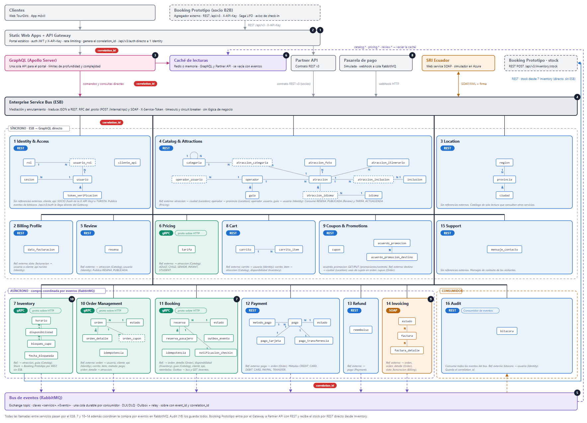

# TourGirls · Atracciones de Ecuador

Portal para descubrir y reservar tours, entradas y experiencias en Ecuador: catálogo con búsqueda y disponibilidad por
turno, carrito, compra con pago simulado, factura electrónica (SRI), cancelación con reembolso, check-in y panel de
administración. Además expone el contrato **OpenAPI v3** para que el socio **Booking Prototipo** venda nuestras
atracciones.

El sistema está construido como **microservicios** (16 servicios `ms-*`, una base de datos cada uno) detrás de un
**API Gateway**, con un **ESB** para las llamadas síncronas y **RabbitMQ** para los eventos.

| Parte | Tecnología | Carpeta |
|---|---|---|
| Portal web | React 19 + Vite + Tailwind | `AtraccionesService-web` |
| API Gateway | NestJS 11 + `http-proxy-middleware` | `apps/gateway` |
| Partner API (contrato v3) | Express, validada contra el YAML | `apps/partner-api` |
| GraphQL del portal | Apollo Server | `apps/graphql` |
| Enterprise Service Bus | Express + `opossum` (circuit breaker) | `apps/esb` |
| Microservicios | Node.js 22 + TypeORM + PostgreSQL | `apps/services/ms-*` |
| Código compartido | TypeScript | `packages/platform` |
| Bus de eventos / caché | RabbitMQ 3.13 / Redis 7.4 | `infra/docker-compose.yml` |

## Contenido

1. [Arquitectura](#arquitectura)
2. [Componentes](#componentes)
3. [Estructura del repositorio](#estructura-del-repositorio)
4. [Patrones de diseño e integración](#patrones-de-diseño-e-integración)
5. [Flujos principales](#flujos-principales)
6. [Seguridad](#seguridad)
7. [Desarrollo local](#desarrollo-local)
8. [Scripts](#scripts)
9. [Calidad y CI](#calidad-y-ci)
10. [Despliegue](#despliegue)

## Arquitectura

Diagrama de arquitectura (componentes, protocolos, bus y tablas de cada servicio):



Tablas y relaciones de cada microservicio:
[.playwright-mcp/tablas.png](.playwright-mcp/tablas.png) (fuente editable:
[Plan/microservicios_tablas_v2.html](Plan/microservicios_tablas_v2.html); la de la arquitectura es
[Plan/arquitectura_esb_v3.html](Plan/arquitectura_esb_v3.html)). El detalle de los atributos está en
[Plan/MODELO_BASE_DE_DATOS.md](Plan/MODELO_BASE_DE_DATOS.md).

### Capas de la solución

```
  Portal web (React)                     Booking Prototipo (socio B2B)
        │  REST /api/v3/auth                   │  REST /api/v3 + X-API-Key
        │  GraphQL /graphql                    │
        ▼                                      ▼
┌─────────────────────────────────────────────────────────────────────────┐
│ API GATEWAY  :3000 (Azure :8080)                                        │
│ CORS · X-Correlation-Id · rate limit · JWT / X-API-Key · principal      │
│ interno firmado · proxy inverso                                         │
└──────┬───────────────────────┬─────────────────────────┬────────────────┘
       │ /api/v3/auth/*        │ /graphql                │ /api/v3/*
       ▼                       ▼                         ▼
 ┌────────────┐      ┌──────────────────┐      ┌──────────────────────┐
 │ ms-identity│      │ GraphQL  :3200   │      │ Partner API  :3100   │
 │ (sesión)   │      │ BFF del portal   │      │ BFF de los socios    │
 └────────────┘      │ caché de lecturas│      │ contrato OpenAPI v3  │
                     └────────┬─────────┘      └──────────┬───────────┘
                              │ POST /call/<servicio>/<operación>
                              ▼                           ▼
┌─────────────────────────────────────────────────────────────────────────┐
│ ESB  :3300   tabla de rutas · JSON → REST / RPC del .proto / SOAP       │
│              timeouts por ruta · circuit breaker · X-Service-Token      │
└───┬──────────────┬───────────────────┬───────────────────┬──────────────┘
    │ REST         │ RPC (.proto       │ SOAP              │ REST + X-API-Key
    ▼              ▼  sobre HTTP)      ▼                   ▼
 ms-identity    ms-pricing          SRI (recepción /    Booking Central
 ms-location    ms-inventory        autorización;       (aviso de check-in)
 ms-catalog     ms-order            sri-mock en local
 ms-billing-…   ms-booking          y en Azure)
 ms-review …
    │              │
    └──────┬───────┘   Outbox + relay
           ▼
┌─────────────────────────────────────────────────────────────────────────┐
│ RabbitMQ   exchange topic · claves <servicio>.<Evento> · cola por       │
│            consumidor · DLX / DLQ                                       │
└─────────────────────────────────────────────────────────────────────────┘
           │
           ▼
 consumidores: ms-order · ms-booking · ms-invoicing · ms-catalog · ms-audit · GraphQL (vacía la caché)

 PostgreSQL: una base por servicio (ms_identity, ms_catalog, …)    Redis: caché de GraphQL y Partner API
```

### Comunicación

| Tipo | Mecanismo | Uso |
|---|---|---|
| Síncrona externa | HTTP a través del Gateway | Portal (REST de sesión + GraphQL) y socios (REST v3) |
| Síncrona interna | ESB (`apps/esb`) | Toda llamada entre componentes: Partner API y GraphQL → servicios, servicio → servicio, servicios → SRI y Booking Central |
| Asíncrona | RabbitMQ (`packages/platform/src/messaging.ts`) | Saga de la compra, facturación, bitácora, promedios de reseñas, precios y vaciado de cachés |
| Directa (excepción) | REST con `X-API-Key` | ms-inventory envía el stock a Booking Prototipo (`POST /api/v3/inventory/stock`), con reintentos desde su outbox |

## Componentes

### Borde e integración

| Componente | Carpeta | Puerto local | Responsabilidad |
|---|---|---|---|
| API Gateway | `apps/gateway` | 3000 | Único punto de entrada público. Autentica, firma el principal interno, agrega `X-Correlation-Id`, limita la tasa y reenvía |
| Partner API | `apps/partner-api` | 3100 | Implementa el contrato OpenAPI v3 para Booking Prototipo; valida cada petición contra el YAML |
| GraphQL | `apps/graphql` | 3200 | API del portal: un campo por operación del ESB, caché de lecturas públicas, límites de profundidad y complejidad |
| ESB | `apps/esb` | 3300 | Enruta `servicio.operación` y traduce JSON a REST, RPC del `.proto` o SOAP. Sin lógica de negocio |
| SRI simulado | `apps/sri-mock` | 4091 | Web services SOAP offline del SRI (recepción y autorización) |
| Booking simulado | `apps/booking-mock` | 4090 / 50051 | Booking Central falso, solo para probar en local sin el socio |

### Microservicios (`apps/services/ms-*`)

Cada uno tiene su propia base PostgreSQL (`ms_<servicio>`) y su contrato en `Plan/ms_<servicio>/`.

| # | Servicio | Puerto | Protocolo | Responsabilidad | Eventos que publica |
|---|---|---|---|---|---|
| 1 | ms-identity | 4018 | REST | Usuarios, roles, sesiones, verificación de correo y clientes API (socios) | Bitácora (ROL_ASIGNADO, CLIENTE_API_CREADO…) |
| 2 | ms-billing-profile | 4013 | REST | Datos de facturación | — |
| 3 | ms-location | 4014 | REST | Regiones, provincias y ciudades (solo lectura) | — |
| 4 | ms-catalog | 4019 | REST | Operadores, guías, categorías, atracciones, fotos, idiomas, itinerario | — |
| 5 | ms-review | 4015 | REST | Reseñas | RESENA_PUBLICADA |
| 6 | ms-pricing | 4026 | RPC (`pricing.proto`) | Tarifas versionadas por tipo de boleto | TARIFA_ACTUALIZADA |
| 7 | ms-inventory | 4025 | RPC (`inventory.proto`) | Horarios, turnos, aforo, bloqueos de cupo; stock hacia Booking | Stock |
| 8 | ms-cart | 4012 | REST | Carrito; cada ítem se compra como una orden | — |
| 9 | ms-coupon | 4011 | REST | Cupones y acuerdo de promociones con Booking | — |
| 10 | ms-order | 4024 | RPC (`order.proto`) | Órdenes, cupones aplicados, seguimiento del pago | OrdenCreada, OrdenPagada |
| 11 | ms-booking | 4023 | RPC (`booking.proto`) | Reservas, compra, cancelación, check-in, voucher | RESERVA_CONFIRMADA, RESERVA_CANCELADA, STOCK_ACTUALIZADO… |
| 12 | ms-payment | 4020 | REST | Pagos con pasarela simulada y webhook firmado | PagoAprobado, PagoRechazado |
| 13 | ms-refund | 4016 | REST | Reembolsos sin superar lo cobrado | ReembolsoEmitido |
| 14 | ms-invoicing | 4021 | SOAP (SRI) | Facturas y notas de crédito electrónicas | — |
| 15 | ms-support | 4017 | REST | Mensajes de contacto | — |
| 16 | ms-audit | 4022 | REST + consumidor | Bitácora de todos los eventos del bus | — |

Los servicios "RPC" implementan el servicio de su `.proto`, pero se exponen como `POST /internal/rpc/<Método>` (el
mensaje del proto en JSON sobre HTTP) y el ESB los invoca así.

### Suscripciones al bus

| Consumidor (cola) | Eventos | Para qué |
|---|---|---|
| ms-order | `payment.PagoAprobado`, `payment.PagoRechazado`, `refund.ReembolsoEmitido` | Marca la orden pagada, rechazada o reembolsada |
| ms-booking | `payment.PagoAprobado`, `payment.PagoRechazado`, `refund.ReembolsoEmitido` | Confirma la reserva o la cancela y libera cupos (compensación) |
| ms-invoicing | `order.OrdenPagada`, `refund.ReembolsoEmitido` | Emite la factura o la nota de crédito al SRI |
| ms-catalog | `review.RESENA_PUBLICADA`, `pricing.TARIFA_ACTUALIZADA` | Recalcula el promedio de calificaciones y el precio "desde" |
| ms-payment | `payment.<webhook>` | Procesa en cola el webhook de la pasarela |
| ms-audit | `#` (todos) | Bitácora con `correlation_id` |
| GraphQL | `catalog.*`, `pricing.*`, `review.*` | Vacía la caché de lecturas |

## Estructura del repositorio

```
apps/
  gateway/              API Gateway (NestJS): app.ts, authentication.ts, config.ts
  partner-api/          Contrato v3 para socios: routes.ts, handlers/, contract.ts (validación contra el YAML)
  graphql/              GraphQL del portal: schema.ts, operations.ts, resolvers.ts, limits.ts
  esb/                  ESB: routes.ts (junta las rutas de cada servicio), soap.ts, app.ts (breaker y timeouts)
  sri-mock/             Simulador SOAP del SRI
  booking-mock/         Booking Central simulado (solo local)
  services/ms-*/        Un microservicio por carpeta:
    src/
      main.ts             Arranque: base de datos, bus, relay del outbox y servidor HTTP
      app.ts              Rutas HTTP / RPC del servicio
      contract.ts         Tipos del contrato (OpenAPI o .proto)
      application/        Casos de uso y reglas de negocio
      integration/        esb-routes.ts (rutas que publica en el ESB) y clientes de otros servicios
      persistence/        data-source, repositorios y migraciones TypeORM
packages/
  platform/             Código transversal: correlation, principal, esb-client, messaging (bus), cache,
                        problem-details, rpc-http, sri, health, logging, persistence/outbox-relay
AtraccionesService-web/ Portal (React): src/api (cliente REST + GraphQL), features, pages
infra/                  docker-compose.yml (PostgreSQL, RabbitMQ, Redis) y scripts de bases
tools/                  launcher.mjs (arranca todo en un proceso), migrate-services.mjs, local-db.mjs,
                        package-microservices.mjs, create-admin.mjs, create-api-key.mjs
test/                   Pruebas de integración y de sistema (E2E del contrato v3 en test/system/v3)
Plan/                   Contratos (OpenAPI, .proto, SQL) por servicio, planes y diagramas
Calidad/                Plan de pruebas, defectos, cobertura y KPIs de CI
```

## Patrones de diseño e integración

### Integración y comunicación

| Patrón | Dónde | Para qué |
|---|---|---|
| **API Gateway** | `apps/gateway/src/app.ts` | Un único punto de entrada: autenticación, correlación, CORS, límite de tasa y enrutamiento centralizados |
| **Reverse Proxy** | `proxy()` en `apps/gateway/src/app.ts` (`http-proxy-middleware`) | Reenvía `/api/v3/auth/*` → Identity, `/api/v3/*` → Partner API y `/graphql` → GraphQL, inyectando las cabeceras de contexto; si el destino no responde, 503 en ProblemDetails |
| **Backend for Frontend (BFF)** | `apps/graphql` (portal) y `apps/partner-api` (socios) | Una API adaptada a cada tipo de cliente: GraphQL expone solo las operaciones del portal; Partner API, solo el contrato v3 |
| **Enterprise Service Bus** | `apps/esb/src/routes.ts`, `app.ts` | Mediación y enrutamiento de todas las llamadas síncronas internas por `servicio.operación` |
| **Protocol Translator / Adapter** | `apps/esb/src/app.ts`, `soap.ts` | El llamador siempre envía JSON; el ESB lo traduce a REST, RPC del `.proto` o SOAP (SRI) |
| **Circuit Breaker** | `opossum` en `apps/esb/src/app.ts` | Corta las llamadas a un destino que falla (50 % de errores) y lo reintenta pasados 10 s |
| **Timeout por ruta** | `timeoutMs` en las rutas del ESB, `ESB_TIMEOUT_FACTOR` | Ninguna llamada queda colgada; se ajusta para Azure |
| **Publish / Subscribe** | `RabbitMqEventBus` en `packages/platform/src/messaging.ts` | Exchange *topic*, claves `<servicio>.<Evento>`, una cola durable por consumidor |
| **Dead Letter Queue** | `<cola>.dlq` y exchange `atracciones.events.dlx` | Un evento que falla tras los reintentos no se pierde ni bloquea la cola |
| **Event envelope (CloudEvents)** | `EventEnvelope` en `messaging.ts` | Formato común con `id`, `type`, `source`, `correlation_id` |
| **Correlation ID** | `packages/platform/src/correlation.ts` (`AsyncLocalStorage`) | El Gateway genera `X-Correlation-Id` y viaja por ESB, servicios, SOAP y eventos; Audit lo guarda |
| **Contract-first** | `Plan/PlanBooking/atracciones-openapi-v3(1).yaml`, `Plan/ms_*/*.proto` y `*-openapi.yaml` | El contrato manda: la Partner API valida contra el YAML v3 y cada servicio sigue el suyo |

### Datos y consistencia

| Patrón | Dónde | Para qué |
|---|---|---|
| **Database per Service** | Una base `ms_*` por servicio, migraciones en `src/persistence/migrations` | Cada servicio es dueño de sus datos; entre servicios solo hay IDs lógicos, sin FK |
| **Transactional Outbox + relay** | `packages/platform/src/persistence/outbox-relay.ts`; `EventPublisher` en ms-booking | El evento se guarda en la misma transacción que el cambio y luego se publica: no hay cambios sin evento ni eventos sin cambio |
| **Saga (orquestada) con compensación** | `apps/services/ms-booking/src/application/purchase-flow.ts`, `payment-events.ts` | La compra cruza Order, Inventory y Payment; si un paso falla se deshacen los anteriores (`ReleaseSeats`, `CancelOrder`) |
| **Idempotency Key** | Cabecera `Idempotency-Key`; `idempotency-repository.ts` en ms-order y ms-booking | Repetir una petición devuelve la misma respuesta sin duplicar efectos |
| **Consumidor idempotente** | `payment-events.ts` (transición solo desde `PENDING`) | Un evento repetido no cambia nada |
| **Cache-aside** | `MemoryCache` / `RedisCache` en `packages/platform/src/cache.ts` | Lecturas públicas de GraphQL y Partner API, invalidadas por eventos |
| **Retry con reintentos programados** | `apps/services/ms-inventory/src/application/booking-stock-sync.ts` | El stock pendiente hacia Booking se reintenta desde el outbox |
| **Repository** | `src/persistence/*-repository.ts` en cada servicio | Aísla el acceso a PostgreSQL de las reglas de negocio |

### Organización del código

| Patrón | Dónde | Para qué |
|---|---|---|
| **Arquitectura en capas** | `application/`, `integration/`, `persistence/` en cada servicio | Separa reglas de negocio, comunicación con otros componentes y datos |
| **Strategy / Adapter de pasarela** | `PaymentGateway` y `SimulatedGateway` en `apps/services/ms-payment/src/integration/gateways` | Cambiar la pasarela sin tocar el caso de uso de pago |
| **Factory** | `createEventBus`, `createGateway`, `createHttpService` | Elige la implementación según la configuración (RabbitMQ o en memoria, etc.) |
| **Shared kernel** | `packages/platform` | Contexto, errores, bus, caché y clientes comunes a todos los componentes |
| **Problem Details (RFC 7807)** | `packages/platform/src/problem-details.ts` | Un único formato de error con `code` estable y `correlation_id`, sin detalles internos |
| **Health check** | `GET /health` en cada componente (`platform/src/health.ts`) | Monitoreo y verificación del despliegue |

## Flujos principales

### Petición autenticada (portal o socio)

```
Cliente ──► Gateway ─ genera X-Correlation-Id
               │      valida Bearer JWT o X-API-Key ──► ESB ──► ms-identity (validateToken / validateApiKey)
               │      firma el principal interno (INTERNAL_TOKEN_SECRET), con caché de unos segundos
               ▼
        Partner API / GraphQL ──► ESB (+ X-Service-Token, principal, correlación) ──► ms-*
                                                          │
                     el servicio verifica el principal y aplica sus permisos (roles / scopes)
```

### Compra (saga)

```
 Partner API / Portal
        │ Idempotency-Key
        ▼
 ms-booking ──1─► ms-catalog      referencia de la atracción y logística (guía)
            ──2─► ms-order        CreateOrder                     ──► outbox: OrdenCreada
            ──3─► ms-inventory    ReserveSeats  ✗ sin cupos ──► compensa: CancelOrder
            ──4─► reserva PENDING + voucher
            ──5─► ms-payment      startPayment  ✗ error     ──► compensa: ReleaseSeats + CancelOrder
                       │
                       │ webhook firmado de la pasarela simulada ──► cola RabbitMQ ──► ms-payment
                       ▼
               payment.PagoAprobado ───────────────┬───────────────────────────┐
                                                   ▼                           ▼
                                        ms-order: PAGADA                ms-booking: CONFIRMED
                                        outbox: OrdenPagada             RESERVA_CONFIRMADA
                                                   │
                                                   ▼
                                ms-invoicing ──► ESB (SOAP) ──► SRI: factura autorizada

               payment.PagoRechazado ──► ms-booking: ReleaseSeats + CANCELLED (SAGA_ORCHESTRATOR)
                                         RESERVA_CANCELADA + STOCK_ACTUALIZADO
```

### Cancelación con reembolso y check-in

```
 Cliente / ADMIN (≥ 24 h antes del turno) o socio por saga (sin plazo)
        │
        ▼
 ms-booking ──► ms-refund (ReembolsoEmitido) ──► ms-order: reembolsada
            ──► ms-inventory: libera cupos     ──► ms-invoicing: nota de crédito (SRI)
            ──► RESERVA_CANCELADA + STOCK_ACTUALIZADO ──► Booking Prototipo (stock)

 Check-in: ms-booking marca la reserva ──► notificacion_checkin ──► ESB ──► Booking Central (X-API-Key)
```

### Stock hacia Booking Prototipo

```
 ms-inventory: cambio de cupos ──► outbox (STOCK_BOOKING) ──► relay ──► POST /api/v3/inventory/stock (X-API-Key)
                                                                  └── falla ──► reintento cada minuto
```

## Seguridad

- **Credenciales externas solo en el Gateway**: `Authorization: Bearer <JWT de ms-identity>` para usuarios y
  `X-API-Key` para socios. Ambas se validan en ms-identity (firma, sesión no revocada, cuenta activa).
- **Principal interno firmado**: el Gateway borra cualquier `X-Internal-Principal` entrante y emite uno firmado con
  `INTERNAL_TOKEN_SECRET`; los servicios lo verifican antes de aplicar roles (`ADMIN`, `TURISTA`, …) o scopes de
  socio (`attractions:read|book|cancel|checkin`, `clients:read|write`).
- **Token de servicio**: el ESB envía `X-Service-Token` (`SERVICE_TOKEN`) a las rutas `/internal/**` de los
  servicios; nadie de afuera puede llamarlas.
- **Webhook de pago** firmado con HMAC (`WEBHOOK_SECRET`).
- **Límite de tasa** por IP en `/api/v3/auth` y `/graphql`; el contrato con Booking no responde 429.
- **GraphQL** con límites de profundidad y de complejidad de las consultas.

## Desarrollo local

Requisitos: Node.js 22 o superior y Docker (para PostgreSQL, RabbitMQ y Redis). Guía detallada:
[Plan/GUIA_LOCAL_TAILSCALE.md](Plan/GUIA_LOCAL_TAILSCALE.md).

```powershell
npm ci
docker compose -f infra/docker-compose.yml up -d     # PostgreSQL :5433, RabbitMQ :5672 (consola :15672), Redis :6379
npm run build
npm run db:migrate                                   # crea las tablas de los 16 servicios
powershell -ExecutionPolicy Bypass -File .\start-microservices.ps1
```

Sin Docker: `npm run db:local` levanta un PostgreSQL embebido, y sin `RABBITMQ_URL` / `REDIS_URL` los servicios
usan el bus y la caché en memoria.

| Servicio | URL local |
|---|---|
| Portal (`cd AtraccionesService-web && npm run dev`) | http://localhost:5173 |
| Gateway | http://localhost:3000 |
| Contrato v3 | http://localhost:3000/api/v3 |
| GraphQL | http://localhost:3000/graphql |
| Consola de RabbitMQ | http://localhost:15672 (guest / guest) |

Administrador: `ADMIN_EMAIL=... ADMIN_PASSWORD=... node tools/create-admin.mjs`.
Clave de API para un socio: `node tools/create-api-key.mjs --codigo BOOKING_PROTOTIPO --nombre "Booking Prototipo"`.

## Scripts

| Comando | Uso |
|---|---|
| `npm run build` | Compila todos los paquetes y aplicaciones (`tsc -b`) |
| `npm run lint` | Chequeo de tipos sin emitir |
| `npm run test:unit` | Pruebas unitarias |
| `npm run test:integration` | Pruebas de integración |
| `npm run test:e2e` | Pruebas de sistema; las del contrato v3 están en `test/system/v3` |
| `npm run db:local` | PostgreSQL embebido con las bases de los microservicios |
| `npm run db:migrate` | Aplica las migraciones de los microservicios |

## Calidad y CI

- [`.github/workflows/pruebas.yml`](.github/workflows/pruebas.yml): lint (tipos), unitarias con cobertura,
  integración y E2E del contrato v3 a través del Gateway.
- [`.github/workflows/deploy-azure.yml`](.github/workflows/deploy-azure.yml): compila, empaqueta
  (`tools/package-microservices.mjs`) y despliega.
- Plan de pruebas, defectos, cobertura y KPIs: carpeta [Calidad/](Calidad/).

## Despliegue

Todo el backend corre en **una sola App Service** (`tourgirls-gateway-mm`): `tools/launcher.mjs` arranca el Gateway
en el puerto público y el resto (Partner API, GraphQL, ESB, SRI simulado y los 16 microservicios) en puertos internos
de `127.0.0.1`. El portal se publica en Azure Static Web Apps. Ambos se despliegan solos con cada push a `main`.

| Servicio | URL |
|---|---|
| Portal web | https://nice-bay-0fae5090f.3.azurestaticapps.net/ |
| Gateway | https://tourgirls-gateway-mm.azurewebsites.net |
| Contrato v3 (socios) | https://tourgirls-gateway-mm.azurewebsites.net/api/v3 |
| Salud | https://tourgirls-gateway-mm.azurewebsites.net/health |

Guía de despliegue: [Plan/DESPLIEGUE_AZURE_MICROSERVICIOS.md](Plan/DESPLIEGUE_AZURE_MICROSERVICIOS.md).
Guía para los socios: [Plan/PlanBooking/GUIA_INTEGRACION_SOCIOS(1).md](Plan/PlanBooking/GUIA_INTEGRACION_SOCIOS(1).md).
